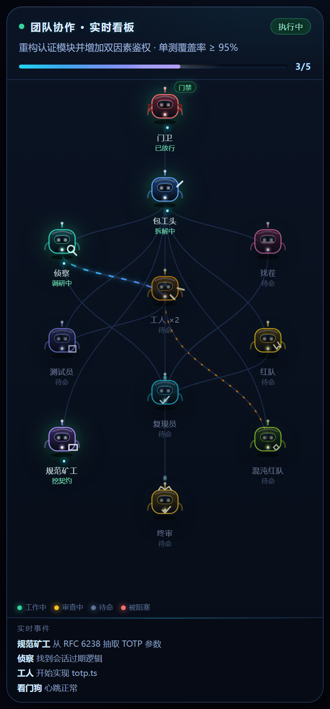
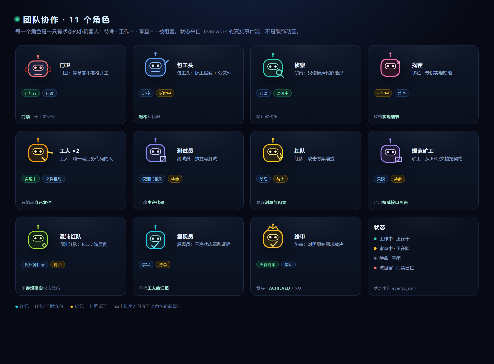

# dsh-teamwork

> 把 [zcode-teamwork](https://github.com/1535273240sch-droid/zcode-teamwork) 的多智能体战役内核搬进 DeepSeek Harness，并配一块会动的 2D 角色实时看板。

[](package.json)
[](LICENSE)
[](https://github.com/deepseek-ai)
[](https://github.com/1535273240sch-droid/zcode-teamwork)

## 这是什么

Teamwork 是一套“工程队 + 独立监理”式的多智能体工作制度：先把目标写成可验收的战役宪章，再把工作拆成里程碑与文件归属表，Worker 只能改自己租约内的文件，验证必须由没参与实现的人写记录，回合结束前门禁检查“有没有真交付、有没有证据”。

本仓库是它的 **DeepSeek Harness 移植版**，包含两部分：

- **Host 插件**：把 ZCode 的 7 个钩子映射到 DSH 的 `systemPrompt.context`、`agent/pre-step`、`tools/pre-execute`、`tools/post-execute`、`agent/turn-stopping`，并把引擎、CLI、11 个角色、看板、看门狗原样 vendored。
- **实时看板（0.7.x 新增）**：窗口右侧悬浮的 2D 面板，11 个机器人按编排关系串联，状态来自 `.teamwork` 的真实事件；没有战役时也会待命呼吸，有战役时自动亮起。

静态效果：



11 个角色：



动态预览（24fps WebP，浏览器打开会动）：[docs/preview.webp](docs/preview.webp)

## 能力

| 上游资产 | 在 DSH 中的形态 |
|---|---|
| `hooks/session-context.mjs` | `ctx.systemPrompt.context('teamwork:charter')` + `agent/created` 预热 |
| `hooks/progress-watch.mjs` | `agent/pre-step`：进度/停滞/看门狗提示 |
| `hooks/ownership-lock.mjs` | `tools/pre-execute`（`write` / `edit`）：写他人租约被拒 |
| `hooks/bash-guard.mjs` | `tools/pre-execute`（`pwsh` / `bash`），附带 PowerShell 写命令翻译 |
| `hooks/spawn-budget.mjs` | `tools/pre-execute`（`subagent` / `subagent_fork` / `spawn_teammate`）：预算、并发、预留 |
| `hooks/audit-log.mjs` | `tools/post-execute`：`events.jsonl` + `evidence/*.log` |
| `hooks/verification-gate.mjs` | `agent/turn-stopping` → `agent.steer(...)`：回合结束前检查验证记录 |
| `commands/teamwork*.md` | `/teamwork`、`/teamwork-status`、`/teamwork-end` |
| `skills/teamwork*` | runtime skills `teamwork`、`teamwork-execute` |
| `agents/*.md` | 11 个角色，经 `teamwork` 工具取全文 |
| `lib/`（engine/CLI/dashboard/watchdog/...） | `teamwork` 工具 32 个动作 + 原样 vendored CLI |
| `scripts/watchdog.mjs` | 常驻 5 分钟 tick + `teamwork watchdog` |
| `scripts/install.mjs` | 由 DSH `plugin_manager` 取代 |
| **实时角色面板** | `shell.overlay` 客户端面板 + `GET /api/teamwork/live` 只读投影 |

### 实时看板

- 位置：窗口右侧悬浮，宽 384px；默认展开，可折叠成竖条。
- 内容：11 个角色机器人（门卫 / 包工头 / 侦察 / 找茬 / 测试员 / 红队 / 工人 ×2 / 规范矿工 / 混沌红队 / 复现员 / 终审）、状态光晕、流动连线、进度条、实时事件。
- 数据：只读读取工作区 `.teamwork` 的 `campaign.json`、`events.jsonl`、`verifications/`、`final-audit.md`；**没有真实事件时不会伪造“工作中”**。
- 动画：纯 SVG + CSS（呼吸、眨眼、扫描、流动虚线、状态过渡），实机 60fps；尊重系统“减少动态效果”。
- 交互：点机器人看职责与当前状态；`—` 收起成**圆形悬浮按钮**（机器人头像 + 进度角标），点按钮再展开；折叠状态记忆在 localStorage。
- 自动行为：战役从无到有时自动展开；战役结束（`.teamwork` 消失）后自动收起；战役进行中手动收起则保持收起，不打扰。

## 安装

### 1. 拿到代码

```bash
git clone https://github.com/1535273240sch-droid/dsh-teamwork.git
cd dsh-teamwork
```

这个包没有 npm 依赖，也不需要构建；`vendor/teamwork` 是上游 43 个文件的原样拷贝。

### 2. 装进 profile

在 DSH 里用 `plugin_manager` 安装本地目录（或在 profile 的 `package.json` 里加 `link:`），例如：

```text
plugin_manager install_bundle target=<本目录绝对路径>
```

然后确认 profile 的 `dsh.profile.bundles` 含 `dsh-teamwork`，并在设置 → 插件里启用。

### 3. 重启一次

Host 代码走 bundle 重载即可生效；**客户端面板是客户端 bundle，安装/更新后需要重启一次 DSH 桌面应用**，重启后右侧会自动出现看板。

## 使用

```text
/teamwork "把认证模块重构并加上双因素鉴权"
/teamwork-status
/teamwork-end            # 预览；/teamwork-end confirm 归档并解除钩子
```

模型侧：

```json
{"action":"init","objective":"..."}
{"action":"plan","milestones":[{"id":"m1","deliverable":"...","files":["src/a.ts"]}]}
{"action":"approve"}
{"action":"advance","phase":"executing"}
{"action":"role","role":"worker"}
{"action":"verify","milestone":"m1","verdicts":[{"role":"critic","result":"SOUND"}]}
{"action":"final","verdicts":[{"role":"success-auditor","result":"ACHIEVED"}]}
```

战役状态在项目根目录的 `.teamwork/`：

```text
.teamwork/
  campaign.json          # 战役宪章（目标、阶段、里程碑、归属）
  plan.json              # 里程碑与文件归属表
  ownership.json         # 文件租约（谁在写、何时过期）
  events.jsonl           # 审计事件流（claimed/denied/tool/dispatch/...）
  evidence/              # 工具输出的证据指纹
  verifications/         # 每个里程碑的独立验证记录
  final-audit.md         # 终审
ORIGINAL_REQUEST.md      # 原始需求（只追加）
```

**没有 `.teamwork/campaign.json` 或未 `approved` 时，所有钩子保持惰性**，不会打扰日常写代码。

## 架构

```text
dsh-teamwork/
  index.js               # Host 适配层：钩子桥、工具、命令、技能、看门狗
  live.js                # /api/teamwork/live 的只读投影（纯 Node 内置模块）
  client.js              # 客户端面板：shell.overlay + 11 机器人 + CSS 动画
  package.json           # dsh.bundle.patch + dsh.client
  cordis.patch.yml       # 插入 teamwork 行
  vendor/teamwork/       # 上游 43 个文件，字节级原样
  docs/                  # 效果图与动态预览
```

数据流：

```text
.teamwork/  ──read──▶  live.js  ──GET /api/teamwork/live──▶  client.js
     ▲                                                        │
     └────────────  hooks (write/edit/bash/audit)  ◀──────────┘
```

## 与上游的差异

1. **阶段名修正**：上游提示词写 `phase: "execution"`，钩子只接受 `approved|executing|verifying`；注册 skill 时已修正为 `"executing"`。
2. **PowerShell 覆盖**：上游 `bash-guard` 只认 POSIX。Windows 上先把 `Set-Content`、`Add-Content`、`Out-File`、`Remove-Item`、`New-Item`、`Copy-Item`、`Move-Item`、`Rename-Item`、`Clear-Content`、`Tee-Object`、`>`/`>>`、`[IO.File]::WriteAllText` 等翻译成等价 POSIX，再交给原钩子。
3. **归属身份**：DSH 每个 subagent/teammate 有自己的 session id，桥接时作为 `agent_id` 传给钩子，修复了上游“同会话归属塌缩、锁永不冲突”的缺陷。
4. **Stop 通道**：`{decision:"block", reason}` 映射为 `agent.steer()`，并遵守 `stop_hook_active` 契约（同一回合只拦一次）。
5. **上下文注入**：宪章走 `ctx.systemPrompt.context` 动态渲染，不塞进消息历史。
6. **未移植**：`scripts/install.mjs`（由 bundle 取代）、`hook-probe` 开发插件、ZCode 的 `/goal` 语义（DSH 有自己的 goal 工具）。

## 验证

- 上游测试套件（`vendor/teamwork` 未改动）：**1116 passed / 0 failed**（11 个 suite）。
- Mock 上下文全链路：命令、技能、工具、5 个事件 listener、网关拦截、审计、归档全部通过。
- DSH 实机：写入他人租约的文件被拒（`File ownership conflict`）；`pwsh Set-Content` 同样被拒；允许的写入产生 `claimed` + `tool` 审计事件与证据指纹。
- 实机 Stop：里程碑标 `done` 但没有验证记录时，回合被拉回并注入门禁原因。
- 看板：`/api/teamwork/live` 用临时战役验证过 `sentinel=done / orch=work / worker=work / critic=verify / auditor=verify / progress=1/2`；无战役时返回全 idle。

## 注意与限制

- Host 插件代码在工作区沙箱之外运行，钩子子进程也不受 DSH 文件沙箱约束。**这是一个协作与审计约束，不是安全沙箱。**
- 角色“权限矩阵”目前靠提示词约束；ZCode 平台级的工具白名单没有 1:1 映射（后续可在派发时用自定义工具裁剪）。
- 客户端面板需要重启 DSH 才会加载；Host 改动用 `plugin_manager set_bundle` 关/开即可重载。
- `/teamwork-end confirm` 归档上游列出的状态文件，不删除 `.teamwork/` 与 `history/`。
- Windows 的 PowerShell 写法无法穷举，`bash-guard` 的翻译层覆盖常见写文件命令，不承诺 100%。

## 版本

- **0.7.1**：折叠态改为圆形悬浮按钮 + 战役开始自动展开 / 结束自动收起。
- **0.7.0**：新增实时 2D 角色看板、`/api/teamwork/live` 只读投影、11 机器人动画与自动展开。
- **0.6.0**：首个 DSH 移植版（7 个钩子、工具、命令、技能、11 角色、看板、看门狗）。

详见 [CHANGELOG.md](CHANGELOG.md)。

## License

MIT。上游版权归 [Teamwork for ZCode contributors](https://github.com/1535273240sch-droid/zcode-teamwork)；DSH 移植与看板部分归本仓库贡献者。见 [LICENSE](LICENSE)。
